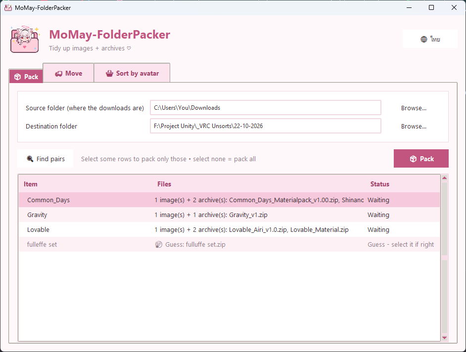
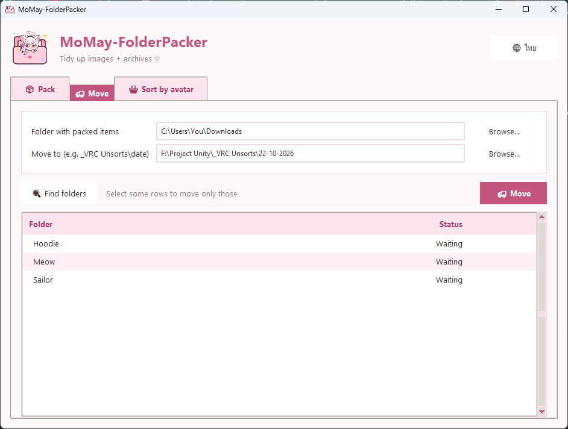
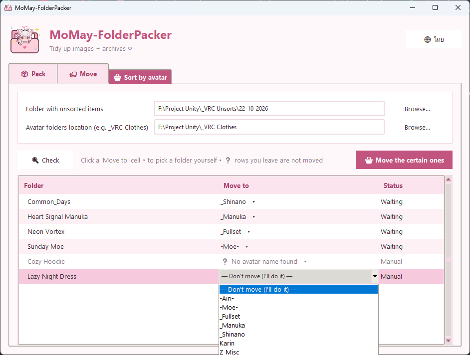

# MoMay-FolderPacker

A small Windows tool that tidies downloaded VRChat assets (clothes, accessories, shaders...) bought from
BOOTH and similar shops. It turns a pile of loose files in your Downloads folder into one neat folder per
item, and can then sort those folders into avatar folders.

The app is in Thai by default. Press the **🌐 English** button (top right) to switch to English, and
**🌐 ไทย** to switch back. The app remembers your choice. The screenshots below are the English version;
the Thai ones are in the `docs` folder (`th-*.png`).

## What it does

Downloads usually look like this: a cover image and one or more archives with related names.

```
Common_Days.jpg
Common_Days_Materialpack_v1.00.zip
Shinano_Common_Days_v1.00.zip
```

The app packs them into this shape:

```
Common_Days/
├── Common_Days.jpg            <- cover image (Windows shows it as the folder picture)
└── Common_Days/
    ├── Common_Days_Materialpack_v1.00.zip
    └── Shinano_Common_Days_v1.00.zip
```

The app has three tabs. They are meant to be used in this order:

1. **จัดไฟล์** (Pack) - loose files into one folder per item
2. **ย้ายโฟลเดอร์** (Move) - move the packed folders somewhere else, for example a dated staging folder
3. **แยกตามอวาตาร์** (Sort) - put each item into the right avatar folder

Files are really moved, not copied. Nothing is ever deleted.

## Running it

- Use `dist\MoMay-FolderPacker.exe` (build it with `build_exe.bat`), or
- run `py organizer_gui.py` (Python 3, nothing extra to install).

Windows only.

In every folder box you can type a path, press **เลือก...** to browse, or drag a folder from
Explorer and drop it onto the box.

## Tab 1: Pack (จัดไฟล์)



1. Set the source folder (where the downloads are) and the destination folder.
2. Press **ค้นหาไฟล์คู่** (find pairs). The list shows every item that has both an image and an archive.
3. Press **จัดไฟล์** (pack). If you select some rows first, only those rows are packed. If you select
   nothing, all the normal rows are packed.

How files are matched:

- An item needs **both** an image and at least one archive. Anything without a partner is left alone.
- The image name is the item name. An archive belongs to it if the image name appears in the archive name
  as a whole word, anywhere: `CPD.jpg` takes `CPD_Prefab_Airi_v1.0.zip`, but not `CPDX.zip`.
- If two images fit an archive, the longer image name wins.
- `X.part1.rar` and `X.part2.rar` count as `X`.

Grey rows marked with a speech bubble are **guesses**: the image and archive have almost the same name
(for example `fulleffe` and `fulluffe`, a typo by the shop). They are never moved automatically. Select
the row yourself if the guess is right.

If a folder with the same name already exists at the destination, the app asks you: choose another
place, merge into the existing folder (same-name files get ` (1)` added), or skip.

## Tab 2: Move (ย้ายโฟลเดอร์)



Finds folders that are already packed and moves the whole folder somewhere else, for example from
Downloads to `_VRC Unsorts\22-10-2026`.

1. Choose the folder that holds the packed folders and press **ค้นหาโฟลเดอร์**.
2. Choose where to move them and press **ย้าย**. Select rows to move only those.

The app will not let you move a folder into itself or into the same folder.

## Tab 3: Sort (แยกตามอวาตาร์)



Moves packed item folders into avatar folders such as `_VRC Clothes\-Airi-` or `_VRC Clothes\_Manuka`.

1. Top box: the folder with items that are not sorted yet.
2. Second box: the folder that contains the avatar folders (for example `_VRC Clothes`).
   These two must be **different** folders.
3. Press **ตรวจสอบ** (check). Every item gets a destination, or a `?` if the app is not sure.
4. Press **ย้ายตัวที่แน่ใจ** to move the items that have a destination.

Each avatar folder name becomes a keyword (`_Manuka` becomes `manuka`, `-Airi-` becomes `airi`).
Adding a new avatar folder is enough for the app to know it. Folders starting with `Z` (like `Z_Misc`)
are ignored. The folder named `full` or `fullset` is where multi-avatar items go.

| Item name | Goes to |
|---|---|
| exactly one avatar name | that avatar's folder |
| two or more avatar names | the Fullset folder |
| the word `full` / `full set` / `fullset` and no avatar | the Fullset folder |
| a number plus `アバター対応` or `avatar` (for example `18アバター対応`) | the Fullset folder |
| `full` plus exactly one avatar | `?` (you decide) |
| no avatar name | `?` (you decide) |

If the item name has no avatar in it, the app also looks at the names of the archives inside the folder,
and then at the file names inside `.zip` files. Those rows say "เดาจากในซิป" (guessed from the zip).
`.rar` and `.7z` cannot be read this way.

Avatars that exist in `_VRC Model` (next to your avatar folders) but have no folder yet show up as `?`
with a note, so you know to create the folder.

**Choosing a folder yourself:** click the **ไปที่** (destination) cell of any row, including `?` rows. A
dropdown with all folders opens. Pick one and the row is moved with the others. Pick
**— ไม่ย้าย (จัดเอง) —** to leave it where it is.

## Good to know

- While big files are moving to another drive, the window may look frozen. Wait for it to finish.
- Pick the right avatar by checking the table before you press the move button. The app only reads
  names, so a name like `Lime` (a colour) can be matched to the avatar Lime.
- Items you leave as `?` are not touched.

## For developers

```
organizer_gui.py            main window
pack_logic.py               pairing and moving (no UI)
sort_logic.py               avatar matching (no UI)
page_pack.py page_move.py page_sort.py    one tab each
ui_theme.py ui_jobs.py ui_dnd.py          theme, dialogs, drag and drop
i18n.py                    all text in Thai and English (add new text here, in both languages)
test_organizer.py           run with:  py test_organizer.py
build_exe.bat               builds dist\MoMay-FolderPacker.exe
```

Only the Python standard library is used. Project rules and the reasoning behind the matching are in
`CLAUDE.md`.
